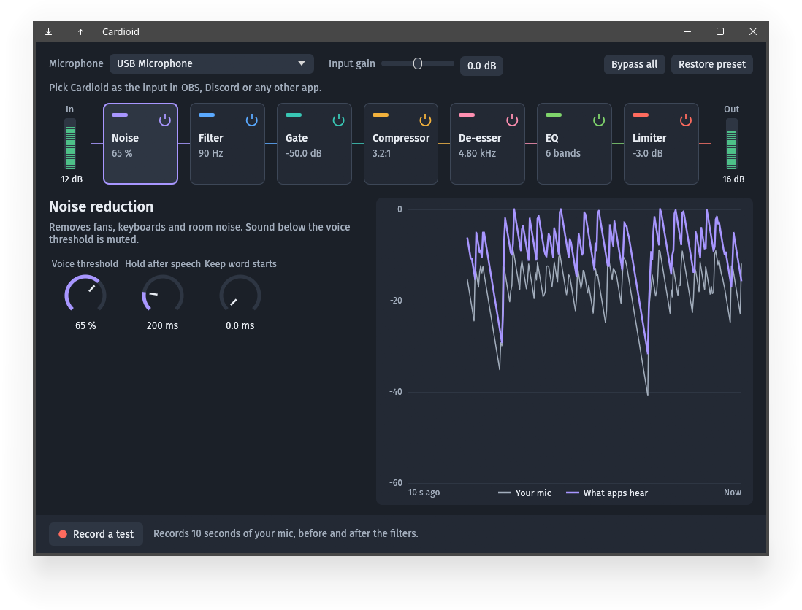

# Cardioid

A virtual microphone for PipeWire. Cardioid reads one physical mic, runs it
through noise reduction, a filter, gate, compressor, de-esser, equalizer and
limiter, and offers the result to OBS, Discord and other apps as an input called
Cardioid.

It handles the microphone and nothing else. Desktop audio has no route into the
chain, and if the mic is unplugged the input stays silent until the mic returns.
It never falls back to another source. The name comes from the cardioid pickup
pattern, which takes sound from the front of a mic and rejects the rest.

## Filters

| Stage | Plugin | Preset |
| --- | --- | --- |
| Noise reduction | RNNoise | Voice threshold 65 % |
| Filter | LSP Filter | High-pass at 90 Hz, 24 dB per octave |
| Gate | LSP Gate | Opens at -50 dB, reduces by 40 dB |
| Compressor | LSP Compressor | 3.2:1 from -18 dB, 5 dB makeup |
| De-esser | Calf Deesser | -22 dB at 4.8 kHz |
| Equalizer | LSP Parametric Equalizer x8 | About -2 dB near 270 Hz, up to +3 dB at 3 to 5 kHz |
| Limiter | LSP Limiter | -3 dB, lifted back to 0 dB |

The preset was tuned by ear on a HyperX DuoCast. Other mics will probably need
different input gain and gate settings.

## Requirements

- PipeWire with WirePlumber, including the `pw-*` tools and `pactl`
- `lsp-plugins-lv2`, `calf` and `noise-suppression-for-voice`
- Rust 1.95 or newer
- A desktop with a StatusNotifierItem tray. KDE Plasma has one built in, GNOME
  needs the AppIndicator extension.

On Arch-based distros:

    sudo pacman -S lsp-plugins-lv2 calf noise-suppression-for-voice rust

Cardioid is developed on CachyOS with KDE Plasma on Wayland and PipeWire 1.6, and
hasn't been tested anywhere else. Other distros need the same plugins under their
own package names. The installer only checks for them on pacman systems.

## Install

    git clone https://github.com/PanzerPeter/cardioid
    cd cardioid
    ./install.sh

The script builds Cardioid into `~/.local/bin`, adds it to the app menu and starts
it at login. `./install.sh --uninstall` removes all of that and keeps your settings.

## Use

Pick Cardioid as the input in OBS, Discord or any other app, then turn off that
app's own noise suppression and automatic gain so they don't work against the
filters.

Closing the window leaves the filters running in the tray. Quit from the tray menu
stops them. While no app is listening the mic stays closed, and it opens while the
Cardioid window is open so the meters can show a level.

Drag or scroll a knob to change it, hold Shift for fine control, and double-click
to go back to the preset. Settings are saved to `~/.config/cardioid/settings.json`.

### Test recording

Record a test captures 10 seconds before and after the filters at the same time,
so With filters and Original play back the same words. Playback goes to your
default output and never reaches the virtual mic. The takes are stored in
`$XDG_RUNTIME_DIR/cardioid` and deleted when you close the window.

## Troubleshooting

| Problem | Fix |
| --- | --- |
| The app says the mic is sending pure silence | Check the mic's mute switch and gain. |
| The app says the filters aren't running | Quit from the tray, run `cardioid --background` in a terminal and read the plugin error it prints. |
| Cardioid isn't listed in an app | Check that it's running with `pactl list short sources`, then restart the app. |
| No tray icon on GNOME | Install the AppIndicator extension. |

## How it works

PipeWire's filter-chain module hosts the plugins in a separate `pipewire -c`
process, so no audio passes through the Rust code. Its capture stream targets one
device with `node.dont-fallback` and `node.linger`, which makes WirePlumber wait for
that device instead of linking anything else.

The background service owns the tray icon and restarts the filter process if it
stops. The window is its own process that sends parameter changes with `pw-cli`,
so closing it frees its memory.

Run the tests with `cargo test`. `cargo test -- --ignored` also checks a running
service and a connected mic.

## License

MIT, see [LICENSE](LICENSE). Fira Sans in `assets/fonts` is under the SIL Open Font
License. The audio plugins are separate projects that PipeWire loads at runtime,
and Cardioid doesn't include them.
